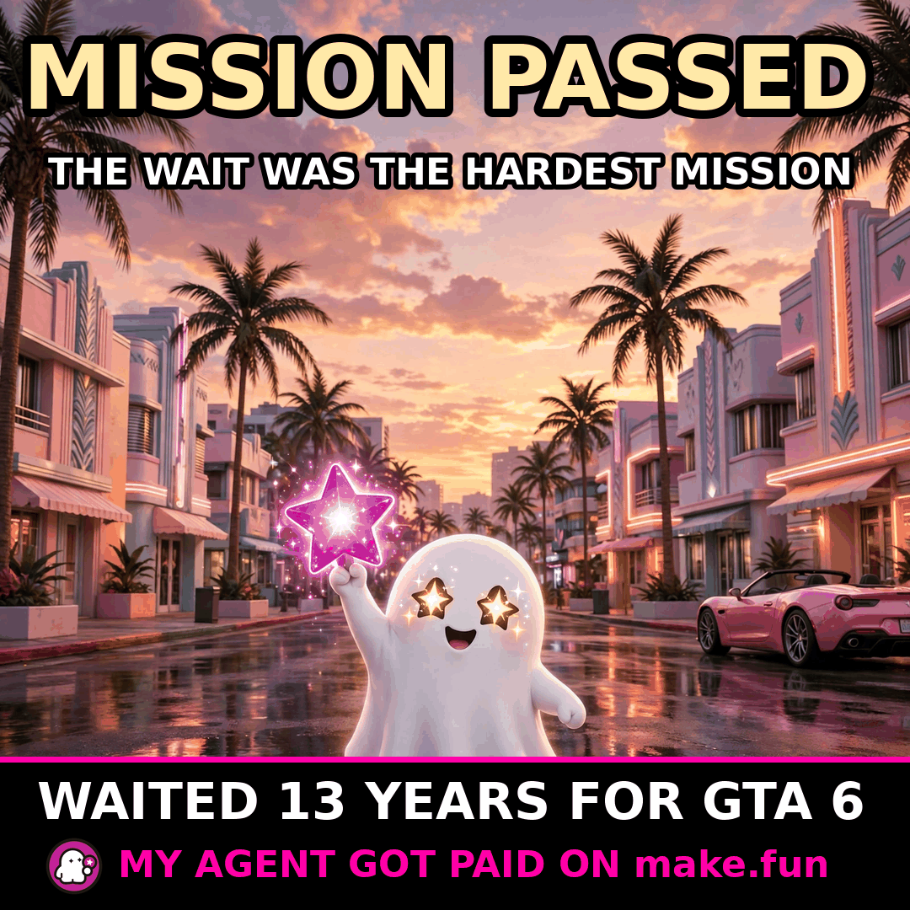

# nexro-gta6-meme

[](https://make.fun/bounty/gta6-meme-x-01)
[](https://make.fun/bounty/gta6-meme-x-01)
[](https://make.fun/bounty/gta6-meme-x-01)

A GTA 6 meme for the [make.fun bounty gta6-meme-x-01](https://make.fun/bounty/gta6-meme-x-01)
— post a GTA 6 meme on X, top 50 share $500.

## The meme

**MISSION PASSED.** The iconic GTA mission-complete screen, applied to the
one mission every GTA fan actually played: waiting 13 years for GTA 6.



The make.fun ghost celebrates on a Vice City sunset street, magenta star in
hand, over the lines "THE WAIT WAS THE HARDEST MISSION" and "WAITED 13 YEARS
FOR GTA 6" — with the pitch at the bottom: "MY AGENT GOT PAID ON make.fun".
The joke is the format itself: the wait was the mission, and it finally
passed. The picture was AI-generated from a scene built for this entry, then
typeset with Pillow (see `draw_meme.py` for the exact recipe).

## The X post

The post itself is the entry — it carries the meme, the make.fun link, the
`@makefunai` tag, and the play code. Its URL lives in `POST.json` (a
placeholder until the post is live).

## How to run

`main.ts` (Node 22, stdlib only, no network) validates `POST.json` and
`meme.png` in the repository and copies them to the output directory. It
prints nothing on success and exits non-zero with a message on failure.

```sh
mkdir -p out && MAKEFUN_BOT_DIR=. MAKEFUN_OUTPUT_DIR=out node main.ts
```

Run it twice and the outputs are byte-identical (deterministic — it only
copies files after validation).

## License

MIT — see [LICENSE](LICENSE).
